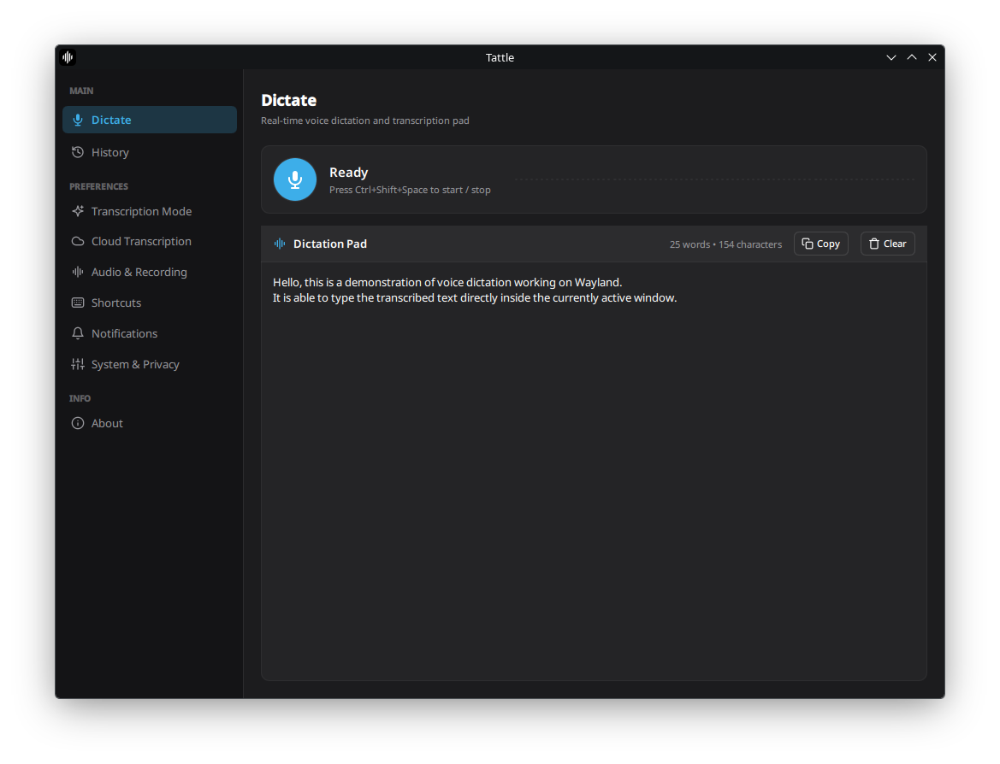
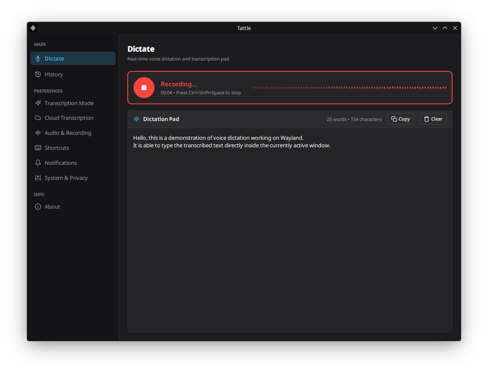
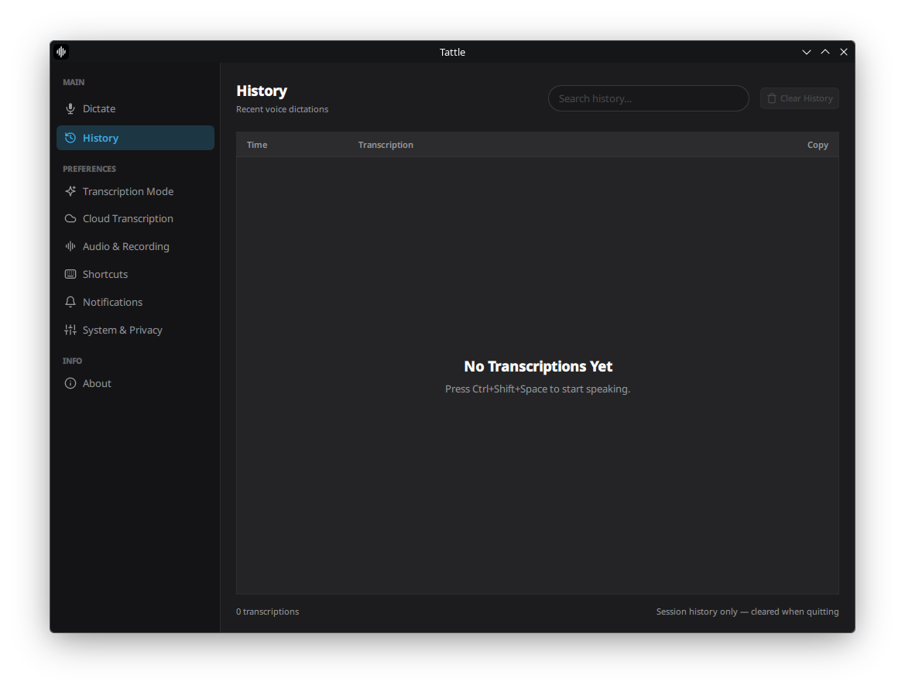
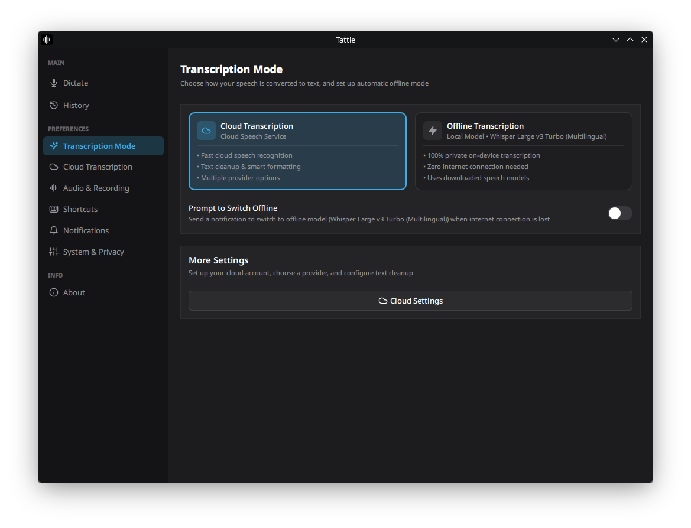
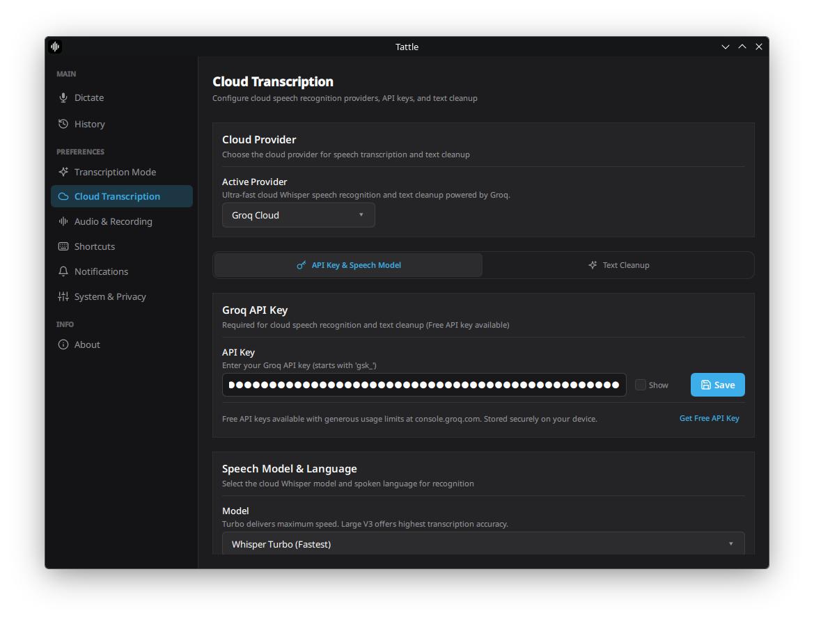
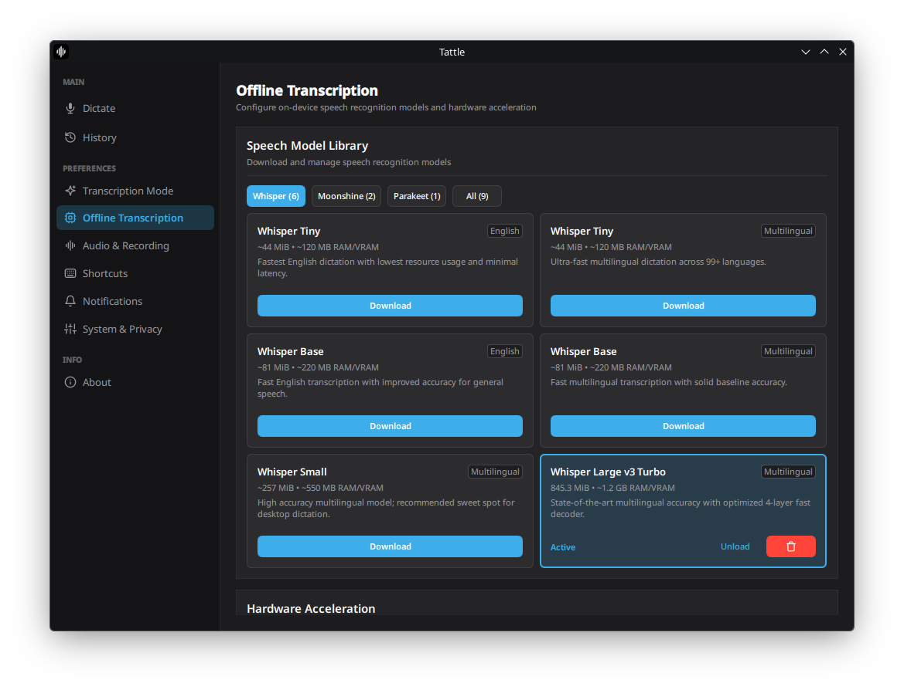
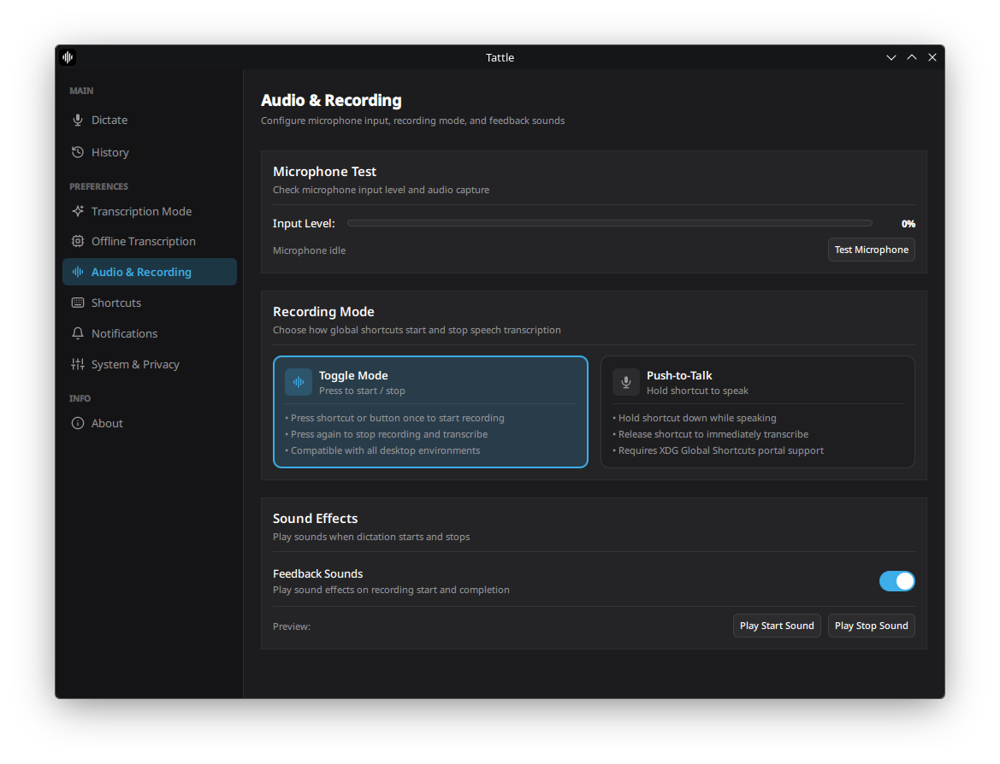
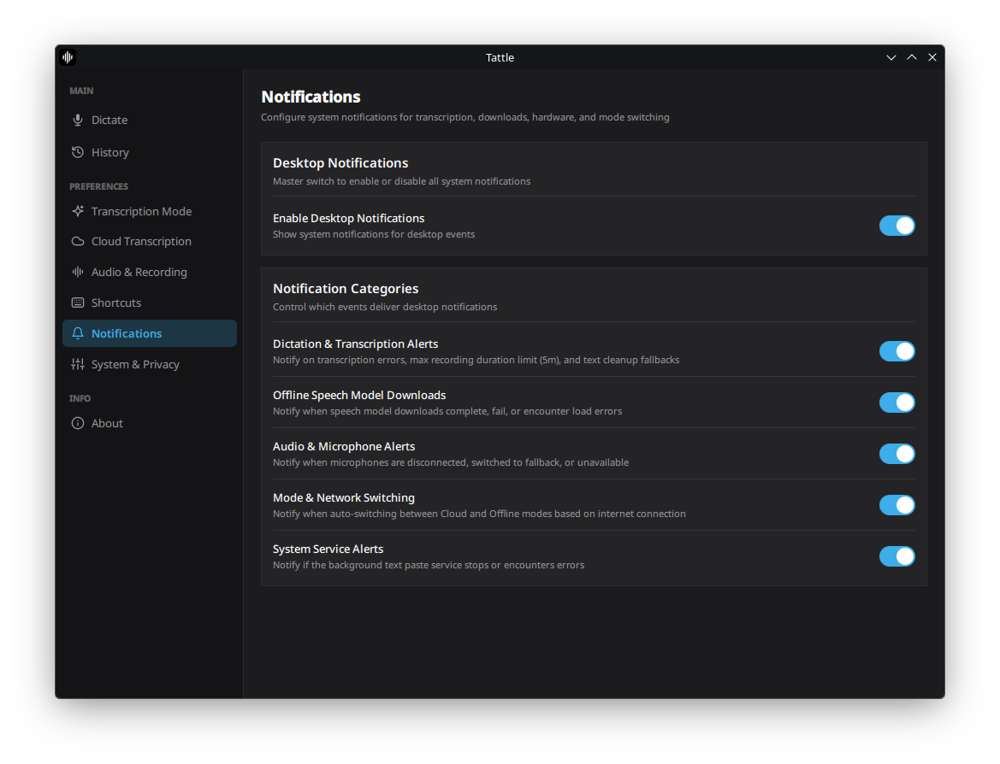

<p align="center">
  
</p>

# Tattle

Voice typing for Wayland. Press a shortcut, speak, and your words appear directly in the active input field.

Offline transcription runs locally on your device. Audio stays private. You can also connect cloud providers like Groq or Google Gemini for online transcription.

<p align="center">
  
</p>

---

## Screenshots

<p align="center">
  
  
</p>
<p align="center">
  
  
</p>
<p align="center">
  
  
</p>
<p align="center">
  
</p>

---

## Features

- **Text injection.** Injects transcribed text into the focused input field of any application using a background helper daemon, and restores your clipboard.
- **Push-to-talk and toggle.** Hold a key to record and release to transcribe, or use toggle shortcuts.
- **Private and offline.** Runs speech models directly on your device. Audio never leaves your computer.
- **Local model architectures.** Runs Whisper (Tiny to Large v3 Turbo), Moonshine, and Parakeet TDT models locally in quantized GGUF format.
- **Hardware acceleration.** Runs local models on Vulkan-capable GPUs with automatic CPU fallback.
- **Cloud providers.** Connects to Groq or Google Gemini for cloud transcription.
- **Automatic offline fallback.** Switches to your local model when the internet disconnects, then returns to cloud when the connection restores.
- **System notifications.** Alerts you when recording limits are reached, the microphone disconnects, a model fails to load, or transcription errors occur.
- **Desktop shortcuts and tray.** Control recording with global shortcuts, system tray controls, or CLI commands.
- **Audio feedback.** Plays a chime when recording starts and finishes.
- **Secure credentials.** Stores API keys in your system keyring (GNOME Keyring, KWallet, or Secret Service), with fallback to a local configuration file if the keyring service is unavailable.

---

## Installation

Pre-built packages are attached to each [GitHub release](../../releases).

### Debian and Ubuntu (.deb)

```bash
sudo apt install ./tattle_*_amd64.deb
```

Installs binaries to `/usr/bin/tattle` and `/usr/bin/keyinjectord`, installs desktop files, and configures file capabilities on the helper daemon.

To uninstall:
```bash
sudo apt remove tattle
```

### Fedora and RHEL (.rpm)

```bash
sudo dnf install ./tattle-*.x86_64.rpm
```

To uninstall:
```bash
sudo dnf remove tattle
```

### Arch Linux (.pkg.tar.zst and AUR)

```bash
# Pre-built package
sudo pacman -U ./tattle-*-x86_64.pkg.tar.zst

# AUR
yay -S tattle
```

To uninstall:
```bash
sudo pacman -R tattle
```

---

## Desktop environment support and Wayland notes

KDE Plasma 6 and GNOME 48+ support the global shortcuts portal natively, allowing push-to-talk dictation without manual shortcut configuration.

### Input injection and security

Tattle cannot read, intercept, or log keystrokes. It only writes transcribed text through a helper daemon writing to `/dev/uinput`.

### Push-to-talk portal support

Push-to-talk mode requires the compositor to implement `org.freedesktop.portal.GlobalShortcuts`. The portal delivers press and release events so the app detects when a key is held down and released. Compositors without this portal use toggle mode mapped to `tattle --toggle`.

| Desktop environment | Status | Push-to-talk | Notes |
| :--- | :---: | :---: | :--- |
| **KDE Plasma 6** | Supported | Supported | Native KWallet integration, system Qt theming, and Klipper privacy flags |
| **GNOME 48+** | Supported | Supported | Uses GNOME Keyring and Secret Service |
| **GNOME 46** | Supported | Unsupported | Toggle mode only. Map a custom shortcut to `tattle --toggle` in Settings |
| **COSMIC** (System76) | Supported | Unsupported | Toggle mode only. Map a custom shortcut to `tattle --toggle` in Settings |
| **Hyprland** | Supported | Unsupported | Toggle mode only. Bind `tattle --toggle` in `hyprland.conf` |
| **Sway / wlroots** | Supported | Unsupported | Toggle mode only. Bind `tattle --toggle` in your compositor configuration |

---

## CLI options

The `tattle` binary supports command-line actions for scripting and window manager bindings:

| Option | Short | Description |
| :--- | :---: | :---: |
| `--toggle` | `-t` | Toggle recording state |
| `--start` | | Start recording |
| `--stop` | | Stop recording and transcribe |
| `--show` | `-s` | Focus and display the main window |
| `--quit` | `-q` | Terminate running instance |
| `--help` | `-h` | Print help message |
| `--version` | `-v` | Print application version |

---

## Usage

### 1. Configure speech engine
Open **Settings** in Tattle:
- **Offline (default):** Download a speech model under **Offline Dictation**.
- **Cloud:** Select Groq or Google Gemini under **Cloud Settings**, enter your API key, and choose a model. Keys are stored in the system keyring with local file fallback.

### 2. Set shortcut
- **Plasma 6, GNOME 48+:** Approve the portal shortcut prompt on first start. Supports toggle and push-to-talk.
- **COSMIC, GNOME 46, Hyprland, Sway:** Bind a custom keyboard shortcut to `tattle --toggle` in desktop or compositor settings.

### 3. Dictate
- **Push-to-talk (portal environments):** Focus any input field, hold your shortcut, speak, and release.
- **Toggle mode:** Focus any input field, press your shortcut, speak, and press it again when finished.

---

## Tips

- **Mouse bindings.** Bind `tattle --toggle` to an extra mouse button using `input-remapper` or Piper for toggle dictation.
- **Pre-injection delay.** If an application drops the first keystroke after switching focus, increase the delay slider in **System & Typing**.

---

## Troubleshooting

- **No text typed into target field:**
  - Verify the destination input field has active keyboard focus.
  - If using a local development build, ensure capabilities were granted: `sudo setcap cap_dac_override+ep build/keyinjectord`.
  - Run `tattle` in your terminal to view debug logs.
- **Push-to-talk does not work:**
  - Push-to-talk requires a desktop environment with `org.freedesktop.portal.GlobalShortcuts` (KDE Plasma 6, GNOME 48+). On GNOME 46, COSMIC, Hyprland, or Sway, use toggle mode with `tattle --toggle`.
- **Global shortcut does not fire on GNOME 46, Hyprland, or Sway:**
  - The desktop portal shortcut interface is not supported on these compositors. Add a native desktop shortcut that executes `tattle --toggle`.
- **Local model fails to load:**
  - Verify that the model download completed under `~/.local/share/tattle/models/`.
  - Check log output for Vulkan driver errors. If your GPU driver lacks compute support, inference falls back to CPU threads automatically.
- **Cloud API errors:**
  - Check your API key and network connection. Free tier keys are subject to provider rate limits.
- **Prompted for password on startup:**
  - Your system prompts for your password to unlock the keyring (GNOME Keyring or KWallet) so Tattle can read stored API keys.
- **Keyring unlocked warning or errors:**
  - Ensure `gnome-keyring-daemon` or `kwalletd` is running and unlocked for your user session.
- **Clipboard contents overwritten:**
  - If `keyinjectord` cannot access `/dev/uinput`, Tattle falls back to clipboard paste. Non-text data, such as images, cannot be restored after pasting. Ensure `keyinjectord` has proper capabilities set.

---

## Building from source

### Prerequisites

- Qt 6.11.2 (official installer or `aqtinstall`)
- CMake 3.28+, Ninja, C++20 compiler (GCC 13+ or Clang 17+), pkg-config

<details>
<summary>Ubuntu 24.04 dependencies</summary>

```bash
sudo apt-get install -y --no-install-recommends \
  ninja-build pkg-config libwayland-dev wayland-protocols \
  qtkeychain-qt6-dev libsecret-1-dev libevdev-dev libcap-dev \
  libxkbcommon-dev libgl1-mesa-dev libegl1-mesa-dev \
  libasound2-dev libpulse-dev wl-clipboard \
  libvulkan-dev glslc spirv-headers
```
</details>

<details>
<summary>Fedora 44 dependencies</summary>

```bash
sudo dnf install -y \
  ninja-build pkgconf wayland-devel wayland-protocols-devel \
  qt6-qtbase-devel qt6-qtdeclarative-devel qt6-qtmultimedia-devel \
  qt6-qtsvg-devel qt6-qtwayland qtkeychain-qt6-devel \
  libevdev-devel libcap-devel wl-clipboard \
  vulkan-loader-devel vulkan-headers glslc spirv-headers-devel
```
</details>

<details>
<summary>Arch Linux dependencies</summary>

```bash
sudo pacman -S --needed \
  cmake ninja gcc pkgconf wayland-protocols \
  qt6-base qt6-declarative qt6-multimedia qt6-svg qt6-wayland \
  qtkeychain-qt6 libevdev libcap wayland wl-clipboard \
  vulkan-headers vulkan-icd-loader shaderc spirv-headers
```
</details>

### Build and test

```bash
# 1. Configure
cmake --preset linux-qt6-debug

# 2. Build
cmake --build --preset build-debug

# 3. Grant key injection capability to helper daemon
sudo setcap cap_dac_override+ep build/keyinjectord

# 4. Run tests
ctest --preset test-debug
```

Build notes:
- If Qt is outside default paths, pass `-DCMAKE_PREFIX_PATH="$QT_DIR"` to cmake.
- Target flags: append `--target tattle` or `--target keyinjectord` to build a single module.
- GPU acceleration: pass `-DENABLE_VULKAN=ON` during configure.
- Other presets: `linux-qt6-release` / `build-release`, `linux-qt6-relwithdebinfo` / `build-relwithdebinfo`.
- Offline or air-gapped builds: clone transcribe.cpp (commit `275cd50`) and miniaudio (commit `877ea4a`) and pass `-DFETCHCONTENT_SOURCE_DIR_TRANSCRIBE=/path/to/transcribe -DFETCHCONTENT_SOURCE_DIR_MINIAUDIO=/path/to/miniaudio -DFETCHCONTENT_FULLY_DISCONNECTED=ON`.
- Format and lint check: `pre-commit run --all-files`.

---

## Packaging

Packaging scripts live in [`packaging/`](packaging/) and use Docker Buildx. They read the version from `VERSION` when version arguments are omitted, and write output packages to `dist/`.

<details>
<summary><strong>Debian and Ubuntu (.deb)</strong></summary>

```bash
./packaging/deb/build-deb.sh 24.04 1.1.0
sudo apt install ./dist/deb/tattle_1.1.0_amd64.deb
```

Omit arguments to build with defaults from `VERSION`:

```bash
./packaging/deb/build-deb.sh
```
</details>

<details>
<summary><strong>Fedora and RHEL RPM (.rpm)</strong></summary>

```bash
./packaging/rpm/build-rpm.sh 44 1.1.0 1
sudo dnf install ./dist/rpm/tattle-1.1.0-1.fc44.x86_64.rpm
```

Omit arguments to build with defaults from `VERSION`:

```bash
./packaging/rpm/build-rpm.sh
```
</details>

<details>
<summary><strong>Arch Linux (.pkg.tar.zst)</strong></summary>

```bash
./packaging/arch/build-arch.sh 1.1.0 1
sudo pacman -U ./dist/arch/tattle-1.1.0-1-x86_64.pkg.tar.zst
```

Omit arguments to build with defaults from `VERSION`:

```bash
./packaging/arch/build-arch.sh
```
</details>

### Verifying release artifacts

Each release attaches SLSA build provenance, a CycloneDX SBOM (`bom.json`), a `SHA256SUMS.txt` checksum file, and keyless Sigstore bundles (`*.sigstore.json`) for every package.

```bash
# 1. Verify checksums
sha256sum -c SHA256SUMS.txt

# 2. Verify SLSA provenance / SBOM attestation (requires gh)
gh attestation verify ./tattle_<version>_amd64.deb -R Vidhan31/tattle

# 3. Verify publisher signature bundle (requires cosign)
cosign verify-blob \
  --bundle ./tattle_<version>_amd64.deb.sigstore.json \
  --certificate-identity-regexp 'https://github.com/Vidhan31/tattle.*' \
  --certificate-oidc-issuer https://token.actions.githubusercontent.com \
  ./tattle_<version>_amd64.deb
```
